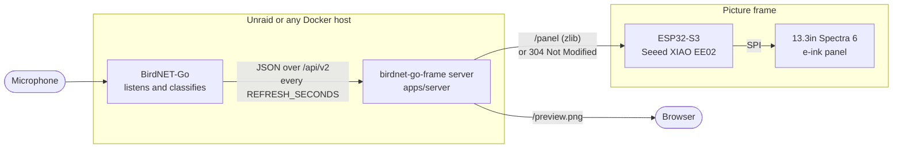
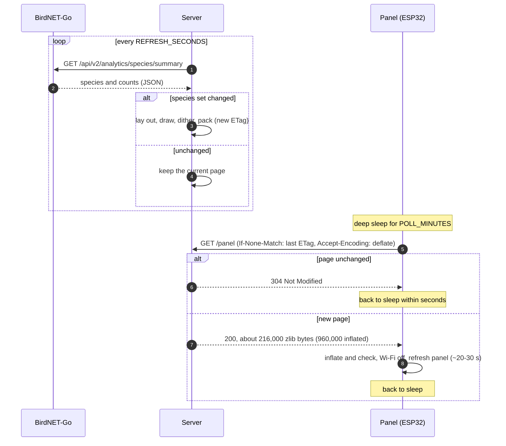

# Architecture: how the pieces fit

All the heavy work happens on a machine that is always on (your Unraid box). The panel is a thin,
battery-powered display that downloads a finished picture only when it has changed.

## What each part does

| Part | Runs on | Job |
| --- | --- | --- |
| BirdNET-Go | Unraid | Detects birds from audio. birdnet-go-frame only reads its HTTP API. |
| Server (`apps/server`) | Unraid | Polls BirdNET-Go, redraws the page when the set of species changes, serves it. |
| Panel firmware | ESP32-S3 | Wakes on a timer, asks for the page with its ETag, redraws only on a change, sleeps. `apps/ee02-thin`, built from `panel-wake` (what to ask, what to do with the answer, how long to sleep, what to remember), `transport-esp` (Wi-Fi with fast rejoin, the HTTP request) and `panel-t133a01` (the panel's controllers). See [the firmware reference](../reference/firmware.md). |

## One cycle, step by step

## Why the work is split this way

- **Rendering needs resources a microcontroller lacks**: fonts, art, and room for a full-colour
  page. The server has all of them for free.
- **The panel's cost is time with the radio on.** Handing it a finished, checksummed picture keeps
  each wake short, and most wakes end in a 304 with no body at all.
- **The format is shared code**, not a spec written twice: `frame-core` is compiled into both the
  server and the firmware (see [Design decisions](design-decisions.md)).

Because every piece is a library, other arrangements are possible too, such as a Raspberry Pi that
renders and drives the panel itself, or an ESP32 that talks to BirdNET-Go directly. See
[Crates and apps](../reference/crates.md).
