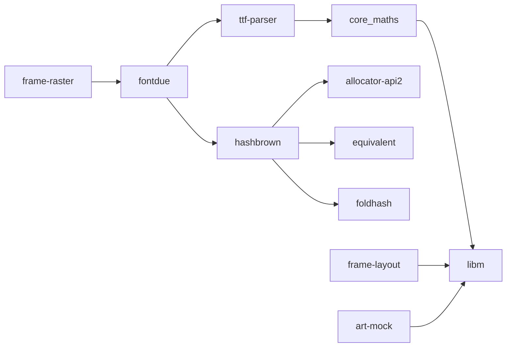

# Dependencies

The server has **eight third-party crates**, all of them the font rasteriser `fontdue` and what
it needs. Everything else is in this repository. This page explains why, and what a new
dependency has to clear.

## What is used

| Crate | Why | Licence |
| --- | --- | --- |
| `fontdue` | Rasterises TrueType glyphs, `no_std`. Writing a font rasteriser is a project of its own. | MIT OR Apache-2.0 OR Zlib |
| `ttf-parser`, `core_maths`, `hashbrown`, `allocator-api2`, `equivalent`, `foldhash` | fontdue's own dependencies (font tables, a `no_std` hash map) | MIT / Apache-2.0 / Zlib |
| `libm` | `sin`, `exp`, `sqrt` for `no_std` float maths. fontdue already brings it, so using it directly adds nothing. | MIT |

`cargo tree -p server -e normal` lists exactly these. `cargo deny check` in CI fails the build on
a licence outside MIT, Apache-2.0, Zlib and CC-BY-4.0, a RustSec advisory, a yanked crate, two
versions of one crate, or a crate from outside crates.io.

### Known issue: ttf-parser is unmaintained

RustSec lists `ttf-parser` as unmaintained
([RUSTSEC-2026-0192](https://rustsec.org/advisories/RUSTSEC-2026-0192)). It has no known
vulnerability, and here it only parses the font embedded in our own binary, never input from
the network, so `deny.toml` accepts it with that reason. If fontdue does not move to a maintained
parser, the options are a fork of fontdue on `skrifa`, or pre-rendering the glyphs the pages use
into a small bitmap font at build time, which would remove all eight crates.

## What was replaced, and with what

The first version used 42 third-party crates. They were replaced with code sized to the job:

| Was | Now | Why it is enough |
| --- | --- | --- |
| `serde`, `serde_json` (+ `syn`, `quote`, `proc-macro2`, …) | `birdnet-model`'s JSON reader, about 250 lines | Two response shapes, read once a minute. No proc macros means faster builds too. |
| `ureq` (+ `http`, `httparse`, `base64`, …) | `lan-http::get` | One plain-HTTP GET on the LAN, with chunked bodies. BirdNET-Go is not reached over TLS. |
| `tiny_http` (+ `ascii`, `chunked_transfer`, …) | `lan-http::Server` | Five GET routes, one request per connection, for a panel and a browser. |
| `png` (+ `flate2`, `miniz_oxide`, `fdeflate`, `crc32fast`, …) | `frame-http`'s PNG writer with a small deflate | Previews compress to the same size; the CRC-32 was already in `frame-core`. |

The server binary went from 1.96 MB to 1.51 MB with the collage and the 158 KB size table
added. Each replacement has tests, including round trips over real sockets and a check that the
deflate stream decodes.

## Adding a dependency

Prefer, in order: the standard library or `core`; a small module in the crate that needs it; a
crate already in the tree; a new crate. A new crate is worth it when the job is genuinely hard
(fonts, TLS, image codecs) or safety-critical. When adding one:

1. Turn off default features and enable only what is used.
2. Keep it out of the `no_std` crates unless it is `no_std` itself.
3. Put it in a tool or app crate rather than a library when only that app needs it (for example
   a future `tools/art-packer` may use an image decoder; the server will not).
4. Add a row to the table above, and check `cargo deny check` passes.
