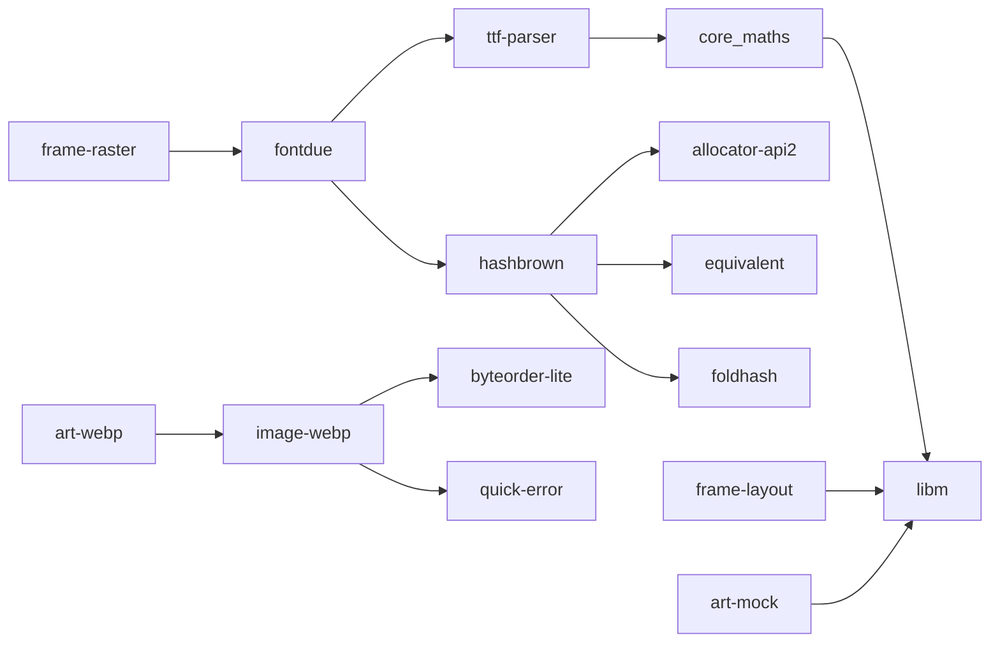

# Dependencies

The server has **eleven third-party crates**: the font rasteriser `fontdue` and what it needs
(eight), and the webp decoder `image-webp` with its two (three), for fugleramme's artwork.
Everything else is in this repository. This page explains why, and what a new
dependency has to clear.

The panel side adds one: `embedded-hal` 1.0 (MIT OR Apache-2.0, no dependencies of its own), the
SPI, pin and delay traits every embedded Rust HAL implements. `panel-t133a01` is written against
it, so the same driver runs on the ESP32 and against the mock bus in its tests. The server does
not link it.

The Raspberry Pi app adds one more, for Linux only: see [The Raspberry Pi app](#the-raspberry-pi-app).
The ESP32 firmware has its own list: see [The firmware](#the-firmware).

## What is used

| Crate | Why | Licence |
| --- | --- | --- |
| `fontdue` | Rasterises TrueType glyphs, `no_std`. Writing a font rasteriser is a project of its own. | MIT OR Apache-2.0 OR Zlib |
| `ttf-parser`, `core_maths`, `hashbrown`, `allocator-api2`, `equivalent`, `foldhash` | fontdue's own dependencies (font tables, a `no_std` hash map) | MIT / Apache-2.0 / Zlib |
| `image-webp` | Decodes the webp plates (lossy and lossless, with alpha). Image codecs are the kind of job worth a crate; it is pure Rust and has no unsafe code. Only `art-webp` uses it, and only the server links `art-webp`. | MIT OR Apache-2.0 |
| `byteorder-lite`, `quick-error` | image-webp's own dependencies | Unlicense OR MIT / MIT OR Apache-2.0 |
| `libm` | `sin`, `exp`, `sqrt` for `no_std` float maths. fontdue already brings it, so using it directly adds nothing. | MIT |

`cargo tree -p server -e normal` lists exactly these. `cargo deny check` in CI fails the build on
a licence outside MIT, Apache-2.0, Zlib and CC-BY-4.0, a RustSec advisory, a yanked crate, two
versions of one crate, or a crate from outside crates.io.

### Known issue: ttf-parser is unmaintained

RustSec lists `ttf-parser` as unmaintained
([RUSTSEC-2026-0192](https://rustsec.org/advisories/RUSTSEC-2026-0192)). It has no known
vulnerability, and here it only parses the font embedded in our own binary, never input from
the network, so `deny.toml` accepts it with that reason. If fontdue does not move to a maintained
parser, the options are a fork of fontdue on `skrifa`, or pre-rendering the glyphs the pages use
into a small bitmap font at build time, which would remove all eight of fontdue's crates.

## The Raspberry Pi app

`apps/linux-panel` drives the panel through Linux's spidev and GPIO character devices, which
takes `ioctl` calls, and the workspace forbids `unsafe`. It uses `linux-embedded-hal`, the
embedded Rust working group's `embedded-hal` 1.0 implementation for Linux, with only its `spi`
and `gpio_cdev` features, on Linux targets only (elsewhere the app still draws pages into a
file).

| Crate | Why | Licence |
| --- | --- | --- |
| `linux-embedded-hal` | SPI and GPIO for the panel drivers on a Raspberry Pi | MIT OR Apache-2.0 |
| `spidev`, `gpio-cdev`, `nix`, `libc`, `bitflags`, `cast`, `nb`, `cfg-if`, `cfg_aliases` | its own dependencies: the two device interfaces and their system calls | MIT / Apache-2.0 |

`gpio-cdev` and `spidev` pin different `nix` releases (0.27 and 0.29), so `deny.toml` lets
`nix` 0.27 in twice, with that reason. Only this app links them.

## The firmware

`apps/ee02-thin`, `apps/ee02-standalone`, `crates/glass-esp` and `crates/transport-esp` build
only for the ESP32-S3; each firmware is its own workspace with its own `Cargo.lock`, and both
lock the same versions. Their twelve direct third-party crates all come from the two projects
that make embedded Rust on the ESP32 work: Espressif's [esp-rs](https://github.com/esp-rs) and
[Embassy](https://embassy.dev). Every one has its default features turned off.

| Crate | Why | Licence |
| --- | --- | --- |
| `esp-hal` | The chip: clocks, GPIO and pad holds, SPI, PSRAM, RTC memory, deep sleep | MIT OR Apache-2.0 |
| `esp-radio` | Wi-Fi, around Espressif's binary radio driver. Still a 1.0 beta, the newest release | MIT OR Apache-2.0 |
| `esp-rtos` | The scheduler `esp-radio` needs, and the embassy executor the firmware runs on | MIT OR Apache-2.0 |
| `esp-alloc` | The heap: internal RAM for the radio, PSRAM for the 960 KB page | MIT OR Apache-2.0 |
| `esp-bootloader-esp-idf` | The app descriptor the ESP-IDF second-stage bootloader checks; the partition table, flash access (through its own `esp-storage`) and `otadata`, for the settings partition and over-the-air updates | MIT OR Apache-2.0 |
| `esp-println`, `esp-backtrace` | Logs and panic messages over the USB serial port | MIT OR Apache-2.0 |
| `embassy-net` | TCP/IP and the DHCP client (on `smoltcp`); IPv4, TCP, and UDP for the setup hotspot's DHCP and DNS answers; no DNS client | MIT OR Apache-2.0 |
| `embassy-executor`, `embassy-time`, `embassy-futures` | The async runtime's types, timeouts, and running the network stack beside the request without a spawned task | MIT OR Apache-2.0 |
| `portable-atomic` | Atomics esp-hal lets live in RTC memory, so keeping state through deep sleep needs no `unsafe`. Already a dependency of esp-hal | Apache-2.0 OR MIT |

They bring about 120 more crates, most of them build-time only (proc macros, `syn`, `toml_edit`
for esp-hal's configuration). That is the price of Espressif's supported stack, and smaller than
the alternative: `esp-idf-svc` builds all of ESP-IDF in C with CMake and Python. Things the
firmware deliberately does without: `static_cell` (the network stack lives in the fetch's own
stack frame, not a `'static`), `log` (it prints directly), `heapless`, `embedded-io-async`, an
HTTP client or server crate (`transport-esp::get` and `serve_http` are short loops over a TCP
socket, and `panel-wake` and `panel-setup` read and write the HTTP), a DHCP server and captive DNS
crate (`panel-setup` answers both in about 200 lines, tested on a laptop), a SHA-256 crate for
updates (the image's XOR checksum is checked before writing, and the bootloader checks its
SHA-256 before booting it), and a zlib crate (`frame_core::inflate_zlib`).

The standalone firmware adds nothing to that list but the server's own `fontdue` and its eight
crates, for drawing the page's words on the chip.

Dependabot watches each firmware's lock file as one group, since Espressif's crates release
together, and the CI firmware build checks each update. `cargo deny` runs on the root workspace
only.

## What was replaced, and with what

The first version used 42 third-party crates. They were replaced with code sized to the job:

| Was | Now | Why it is enough |
| --- | --- | --- |
| `serde`, `serde_json` (+ `syn`, `quote`, `proc-macro2`, …) | `lite-json`, about 250 lines | Two response shapes read once a minute, plus `geometry.json` and translations at start-up. No proc macros means faster builds too. |
| `ureq` (+ `http`, `httparse`, `base64`, …) | `lan-http::get` | One plain-HTTP GET on the LAN, with chunked bodies. BirdNET-Go is not reached over TLS. |
| `tiny_http` (+ `ascii`, `chunked_transfer`, …) | `lan-http::Server` | Five GET routes, one request per connection, for a panel and a browser. |
| `png` (+ `flate2`, `miniz_oxide`, `fdeflate`, `crc32fast`, …) | `frame-http`'s PNG writer and a small zlib encoder (hash chains, lazy matching, dynamic Huffman) | Panel pages and PNGs come within 7 percent of zlib's best level; the CRC-32 was already in `frame-core`. |

The server binary went from 1.96 MB to 1.51 MB with the collage and the 158 KB size table
added; the webp decoder, spiral packing and translations bring it to 1.70 MB. Each replacement has tests, including round trips over real sockets and a check that the
deflate stream decodes.

## Adding a dependency

Prefer, in order: the standard library or `core`; a small module in the crate that needs it; a
crate already in the tree; a new crate. A new crate is worth it when the job is genuinely hard
(fonts, TLS, image codecs) or safety-critical. When adding one:

1. Turn off default features and enable only what is used.
2. Keep it out of the `no_std` crates unless it is `no_std` itself.
3. Put it in a tool or app crate rather than a library when only that app needs it (for example
   only `art-webp` decodes images, so the ESP32 firmware will not link `image-webp`).
4. Add a row to the table above, and check `cargo deny check` passes.
