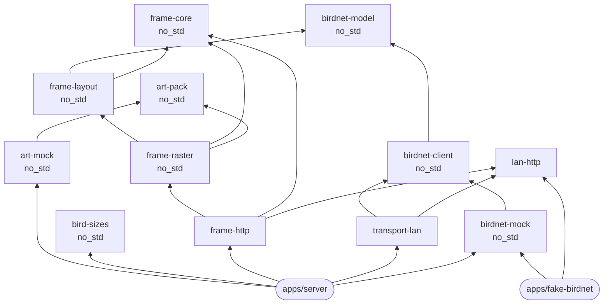

# Design decisions

## Rust for the server and the firmware

One language means one definition of the page format, the inks and the panel geometry,
compiled into every binary. Espressif maintains Rust support for the ESP32 (`esp-hal`,
`esp-idf-svc`), and the server builds to a static binary of under 2 MB.

## Everything is a library; apps only wire them together

Libraries talk to the outside world through small traits, so the same code runs in different
places:

| Trait | Lets you swap |
| --- | --- |
| `HttpTransport` (`birdnet-client`) | Desktop networking (`transport-lan`), the simulated station (`birdnet-mock`), or ESP32 networking (planned) |
| `ArtSource` (`art-pack`) | Where bird pictures come from: generated (`art-mock`), files on disk, or an SD card (planned) |
| `embedded-hal` 1.0 traits (planned, `panel-t133a01`) | Which board drives the panel: ESP32 or a Raspberry Pi |

## `no_std` wherever possible

A library uses the standard library only if its job needs an operating system (`lan-http`,
`transport-lan`, `frame-http`). Everything else is `no_std` with `alloc`, so it also compiles for the ESP32. That
keeps an ESP32 that renders the page itself, with no server, a realistic option.

## Byte compatibility with fugleramme

The `/frame.e6` format is fugleramme's, verified by golden tests. Either project's server works with
either project's panel firmware, which also let the server be tested on real hardware before our
own firmware existed.

## Built-in mocks

`birdnet-mock` simulates a BirdNET-Go whose output depends only on the time asked, so tests are
deterministic and nobody needs a microphone to work on the frame. It is available in-process
(`BIRDNET_URL=mock`) and over HTTP (`apps/fake-birdnet`). `art-mock` does the same for pictures:
it paints a bird for any species, so the collage works without downloading any artwork.

## Plain HTTP to BirdNET-Go

BirdNET-Go is reached on the home network, so the server ships without a TLS stack, which would
otherwise make up most of the binary. `lan-http` speaks just enough HTTP/1.1 for that.

## Few dependencies

Eight third-party crates, all for font rendering. JSON, HTTP and PNG are small modules in this
repository instead. See [Dependencies](dependencies.md).

## Code style

Google's Rust Style Guide, enforced by `rustfmt.toml`, workspace lints and CI. See
[STYLE.md](../../STYLE.md).
