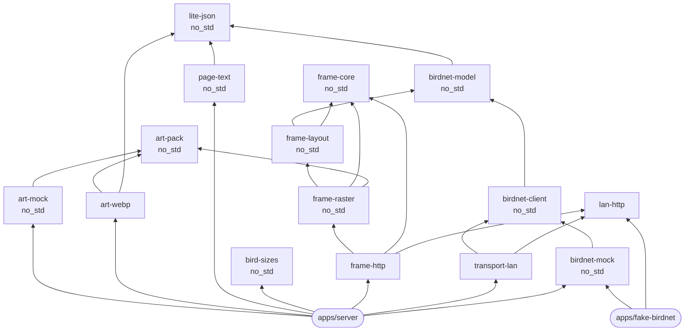

# Design decisions

## Rust for the server and the firmware

One language means one definition of the page format, the inks and the panel geometry,
compiled into every binary. Espressif maintains Rust support for the ESP32 (`esp-hal`,
`esp-idf-svc`), and the server builds to a static binary of under 2 MB.

## Everything is a library; apps only wire them together

Libraries talk to the outside world through small traits, so the same code runs in different
places:

| Trait | Lets you swap |
| --- | --- |
| `HttpTransport` (`birdnet-client`) | Desktop networking (`transport-lan`), the simulated station (`birdnet-mock`), or ESP32 networking (planned) |
| `ArtSource` (`art-pack`) | Where bird pictures come from: generated (`art-mock`), fugleramme's webp folders (`art-webp`), or an SD card (planned) |
| `embedded-hal` 1.0 traits (`panel-t133a01`) | Which board drives the panel: ESP32, a Raspberry Pi, or the mock bus in its tests |

## `no_std` wherever possible

A library uses the standard library only if its job needs an operating system (`lan-http`,
`transport-lan`, `frame-http`). Everything else is `no_std` with `alloc`, so it also compiles for the ESP32. That
keeps an ESP32 that renders the page itself, with no server, a realistic option.

## fugleramme's pixels, without the `.e6` header

The pixel bytes `/panel` serves are fugleramme's controller layout, verified by golden tests. The
20-byte `.e6` header around them is gone: fugleramme needed it because its MicroPython firmware
cannot decode a PNG and had nowhere else to read the panel size, a checksum and the poll time.
Over HTTP the request names the panel, the inflated length catches a mismatch, zlib carries a
checksum, and `Cache-Control: max-age` gives the poll time. Without the header the body can be
compressed, so a new page moves about a quarter of the bytes. The cost is that fugleramme's EE02
firmware needs a few lines changed to read `/panel`
([how](../how-to/show-on-ee02.md)); a Rust firmware reads it directly.

## Built-in mocks

`birdnet-mock` simulates a BirdNET-Go whose output depends only on the time asked, so tests are
deterministic and nobody needs a microphone to work on the frame. It is available in-process
(`BIRDNET_URL=mock`) and over HTTP (`apps/fake-birdnet`). `art-mock` does the same for pictures:
it paints a bird for any species, so the collage works without downloading any artwork.

## Plain HTTP to BirdNET-Go

BirdNET-Go is reached on the home network, so the server ships without a TLS stack, which would
otherwise make up most of the binary. `lan-http` speaks just enough HTTP/1.1 for that.

## Few dependencies

Eleven third-party crates in the server: font rendering and the webp decoder. The panel side
adds `embedded-hal`. JSON, HTTP, PNG and zlib (both ways) are small modules in this repository
instead. See [Dependencies](dependencies.md).

## Code style

Google's Rust Style Guide, enforced by `rustfmt.toml`, workspace lints and CI. See
[STYLE.md](../../STYLE.md).
