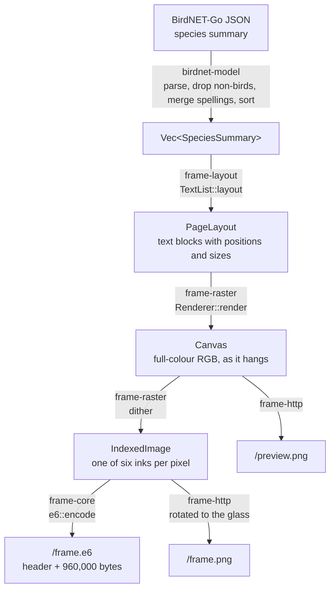
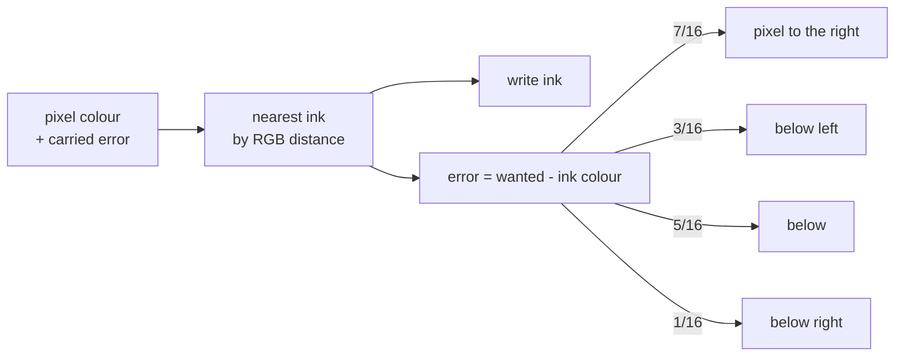
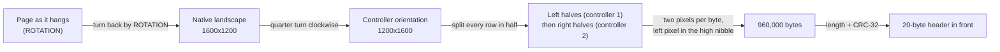

# How the image is made

A page goes through five stages, from BirdNET-Go's JSON to the bytes the panel's controllers
expect. Each stage is a separate crate with plain data in and out, so each can be tested alone.

## 1. Parse (`birdnet-model`)

The server asks for `GET /api/v2/analytics/species/summary?start_date=…&end_date=…`, covering the
last `WINDOW_HOURS` in your time zone. The parser:

- drops BirdNET's non-animal labels (`Engine`, `Dog`, …), which use the same text for both names;
- merges rows that name the same species differently (BirdNET-Go keeps old spellings after a
  reclassification), adding their counts;
- sorts by count, most detections first.

## 2. Lay out (`frame-layout`)

Layout decides *what goes where* without drawing anything. The output is a `PageLayout`: a list
of text blocks, each with text, position, size, alignment and a role (heading, name, detail,
footer).

The current layout, `TextList`, puts a heading at the top, the species with their counts below it
and an "Updated HH:MM" footer at the bottom. Long lists on a landscape page get two columns.
All names share one font size, small enough for the longest name to fit beside its count.

The illustrated collage from fugleramme (art sized by body mass and packed onto the page) will be
a second layout producing the same kind of `PageLayout`.

## 3. Draw (`frame-raster`)

The renderer starts from a white canvas the size of the page *as it hangs* (1600x1200 landscape or
1200x1600 portrait) and draws each block with the embedded EB Garamond Italic, using `fontdue`.
Names and the heading are black, counts are red.

Glyph edges are drawn hard (coverage of 50% or more is ink, less is paper). Smooth grey edges look
nice on a monitor, but the next stage would turn them into coloured specks, because grey is not
one of the panel's inks.

## 4. Dither (`frame-raster`)

A Spectra 6 panel can show exactly six colours. Dithering picks one per pixel and spreads the
rounding error to the neighbours (Floyd-Steinberg), so areas of in-between colour come out as a
fine mix of inks that the eye blends back together.

Distances are measured against how the inks actually look on the glass, not their nominal
colours. These are fugleramme's blend of the panel's saturated and desaturated palettes:

| Ink | Dither colour (RGB) | Controller code |
| --- | --- | --- |
| Black | 0, 0, 0 | 0 |
| White | 208, 209, 210 | 1 |
| Yellow | 231, 222, 35 | 2 |
| Red | 205, 36, 37 | 3 |
| Blue | 30, 29, 174 | 5 |
| Green | 29, 173, 35 | 6 |

## 5. Pack for the panel (`frame-core`)

The 13.3" glass is driven by two T133A01 controllers, each handling one half of every row, in the
glass's own orientation. `e6::encode` therefore:

The result is byte-for-byte what fugleramme's `/frame.e6` produces for the same page (checked by
golden tests in `crates/frame-core/tests/e6_golden.rs`), so firmware written for either works with
both. The exact layout is in [The E6F1 page format](../reference/e6-format.md).

## The three outputs

| Endpoint | Made from | Orientation | Colours |
| --- | --- | --- | --- |
| `/frame.e6` | dithered page | controller orientation | 4-bit controller codes |
| `/frame.png` | dithered page | native landscape | six nominal ink colours |
| `/preview.png` | canvas before dithering | as it hangs | full colour |

All three share one ETag, derived from the E6F1 bytes, so they change together.
