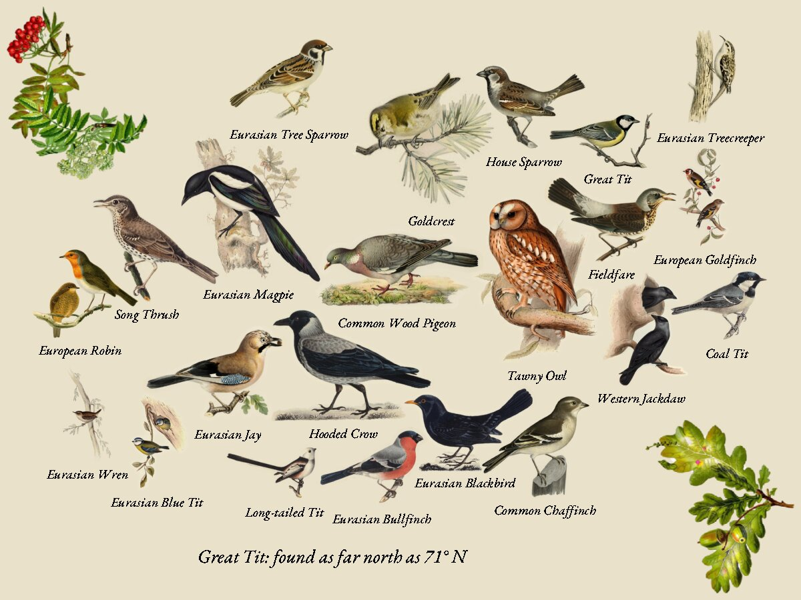
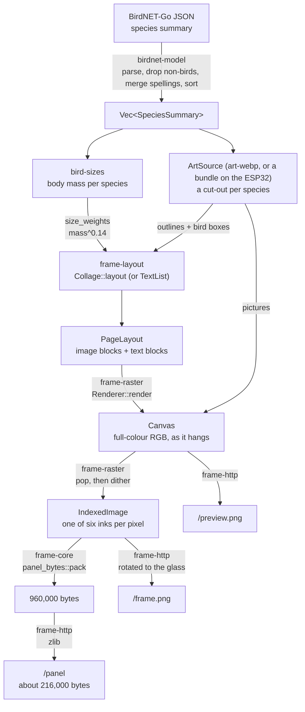
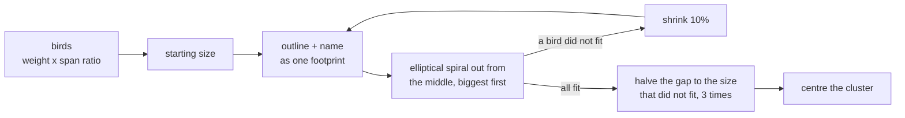
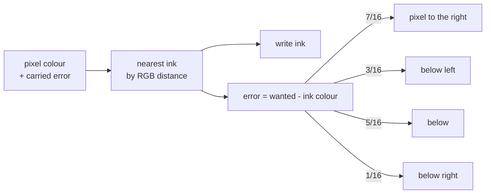

# How the image is made

*The simulated garden drawn with `ART_DIR` set to fugleramme's `classic` style. Artwork: 1800s
plates (von Wright, Gould and others) curated and edited by fugleramme, CC BY-SA 4.0.*

A page goes through six stages, from BirdNET-Go's JSON to the bytes the panel's controllers
expect. Each stage is a separate crate with plain data in and out, so each can be tested alone.

## 1. Parse (`birdnet-model`)

The server asks for `GET /api/v2/analytics/species/summary?start_date=…&end_date=…`, covering the
last `WINDOW_HOURS` in your time zone. The parser:

- drops BirdNET's non-animal labels (`Engine`, `Dog`, …), which use the same text for both names;
- merges rows that name the same species differently (BirdNET-Go keeps old spellings after a
  reclassification), adding their counts;
- sorts by count, most detections first.

## 2. Pictures (`art-webp`)

With `ART_DIR` set, pictures are fugleramme's own artwork: hand-coloured 1800s plates, cut out
around the bird (often with its branch or patch of ground) and saved as `birds/<genus>-<species>.webp`,
with numbered variants (`-2`, `-3`). `ArtFolder` follows fugleramme for each species:

1. **Variant.** One plate per species per day, picked by a hash of the name and the date, so a
   bird in the garden all week still changes, and a restart changes nothing.
2. **Trim and shrink.** The plate is cropped to its opaque pixels and shrunk to at most 800 px.
3. **Bird box.** `geometry.json` records where the bird itself is on each plate. A layout sizes
   the *bird*, not the plate, so a wren on a big branch is not drawn tiny.
4. **Paper halo.** Each plate keeps a ring of its scanned paper, whose tone varies from scan to
   scan. The ring's median tone is measured, paper-like pixels are shifted to the page's paper,
   the outer ring is snapped flat, and the cut edge is feathered inwards. Every plate then looks
   printed on one sheet.

Without `ART_DIR` the source is `NoArt` (in `art-pack`), which has no pictures; a collage with
no pictures is drawn as the list, so the server works with nothing installed. Nothing ever draws
made-up birds. Unit tests of layout use `OutlineArt`, plain ovals that are cut-outs like real
plates; the pages in the docs and CI's real-art job use fugleramme's plates.

## 3. Lay out (`frame-layout`)

Layout decides *what goes where* without drawing anything. The output is a `PageLayout`: image
blocks (which picture, where, how big, mirrored or not) and text blocks (text, position, size,
alignment and a role: heading, name, detail, footer).

### The collage (`LAYOUT=collage`, the default)

A port of fugleramme's collage. The page is birds only: no heading or footer unless `HEADING`
is set.

1. **Weight.** `bird-sizes` looks up the body mass (AVONET; unknown species get the median), and
   `size_weights` compresses it as fugleramme does: `(mass / geometric mean) ^ 0.14`. A wood
   pigeon comes out about 1.9 times the size of a goldcrest, not 90 times. The weight is then
   multiplied by how much bigger the plate is than its bird.
2. **Starting size.** The set starts at
   `min(sqrt(page area x 1.5 / sum of weights squared), short side x 0.7 / largest weight)`.
3. **Footprints.** Each bird's outline (alpha above 24) is resampled to its size, mirrored if a
   hash of its name says so, and shrunk by 2 px so neighbours nestle into each other's invisible
   halos. Its name is joined underneath, centred on the body rather than the box and raised
   until it clears the outline: into the gap beside a leg or under a perch.
4. **Spiral.** Biggest first, each footprint goes at the first spot on an outward walk from the
   middle of the page where no opaque pixel overlaps. The walk follows ellipses 6 px apart with
   the page's own proportions, so the cluster takes the page's shape and reaches into its
   corners, where circles would leave them bare. Biggest birds land in the middle.
5. **Find the size.** If any bird does not fit, the whole set shrinks by 10% and packs again.
   Once it fits, the gap to the size that did not is halved three times, so the birds come out
   as big as the page allows; a set that fits at once grows by 6% steps instead. Names shrink
   with the set; at the end, names left small beside a few big birds are grown back as far as
   the packing allows.
6. **Centre.** The cluster's bounding box is centred on the page.

The page is packed at a short side of 1200 pixels and scaled, so a page packs the same at every
resolution.

### The list (`LAYOUT=list`)

`TextList` puts the species with their counts under the heading. Long lists on a landscape page
get two columns. All names share one font size, small enough for the longest name to fit beside
its count.

## 4. Draw (`frame-raster`)

The renderer starts from a canvas of fugleramme's panel paper, a warm cream (233, 225, 202), the size of the page *as it hangs* (1600x1200 landscape or
1200x1600 portrait). It draws the pictures first, scaling each into its block by averaging the
source pixels under every target pixel and blending by the picture's transparency. Then it draws
each text block with the embedded EB Garamond Italic, using `fontdue`. Names and the heading are
black, counts are red.

Glyph edges are drawn hard (a quarter coverage or more is ink, less is paper; any higher and
the italic's hairlines break apart at small sizes). Smooth grey edges look
nice on a monitor, but the next stage would turn them into coloured specks, because grey is not
one of the panel's inks.

## 5. Dither (`frame-raster`)

First `pop` darkens the pictures and adds contrast (fugleramme's per-channel lift, pivot 182,
contrast 1.15), because pale plumage would otherwise dither to bare paper. The paper, and the
halos reachable from it through near-paper pixels, keep their tone, or every bird would wear a
dark ring.

A Spectra 6 panel can show exactly six colours. Dithering picks one per pixel and spreads the
rounding error to the neighbours (Floyd-Steinberg), so areas of in-between colour come out as a
fine mix of inks that the eye blends back together.

Distances are measured against how the inks actually look on the glass, not their nominal
colours. These are fugleramme's blend of the panel's saturated and desaturated palettes:

| Ink | Dither colour (RGB) | Controller code |
| --- | --- | --- |
| Black | 0, 0, 0 | 0 |
| White | 208, 209, 210 | 1 |
| Yellow | 231, 222, 35 | 2 |
| Red | 205, 36, 37 | 3 |
| Blue | 30, 29, 174 | 5 |
| Green | 29, 173, 35 | 6 |

## 6. Pack for the panel (`frame-core`)

The 13.3" glass is driven by two T133A01 controllers, each handling one half of every row, in the
glass's own orientation. `panel_bytes::pack` therefore:

```mermaid
flowchart LR
    hang["Page as it hangs<br/>(ROTATION)"] -->|"turn back by ROTATION"| land["Native landscape<br/>1600x1200"]
    land -->|"quarter turn clockwise"| glass["Controller orientation<br/>1200x1600"]
    glass -->|"split every row in half"| halves["Left halves (controller 1)<br/>then right halves (controller 2)"]
    halves -->|"two pixels per byte,<br/>left pixel in the high nibble"| bytes["960,000 bytes"]
    bytes -->|"zlib, for clients that accept deflate"| wire["about 216,000 bytes"]
```

The bytes are what fugleramme's `/frame.e6` carries after its header for the same page (checked by
golden tests in `crates/frame-core/tests/panel_bytes_golden.rs`). `frame-http` then compresses them
with its own zlib encoder: dithered pictures repeat a lot, so the panel downloads about a quarter
of the bytes. The exact layout, and why fugleramme's header is not needed, are in
[The panel format](../reference/panel-format.md).

## The three outputs

| Endpoint | Made from | Orientation | Colours |
| --- | --- | --- | --- |
| `/panel` | dithered page | controller orientation | 4-bit controller codes, zlib-compressed |
| `/frame.png` | dithered page | native landscape | six nominal ink colours |
| `/preview.png` | canvas before the boost and dithering | as it hangs | full colour |

All three share one ETag, derived from the panel's bytes, so they change together.
