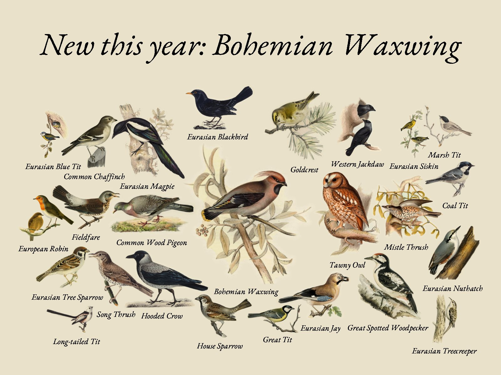
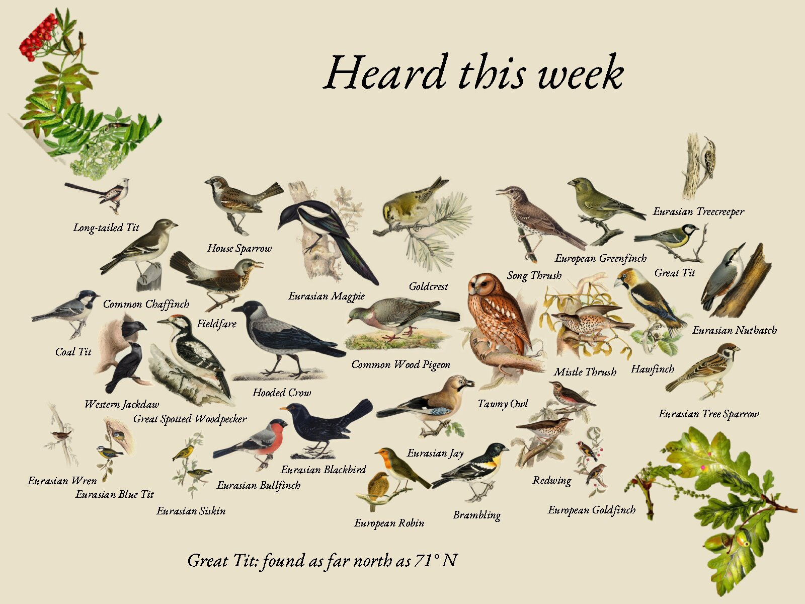
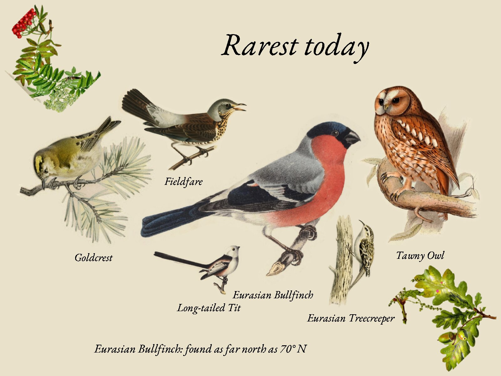
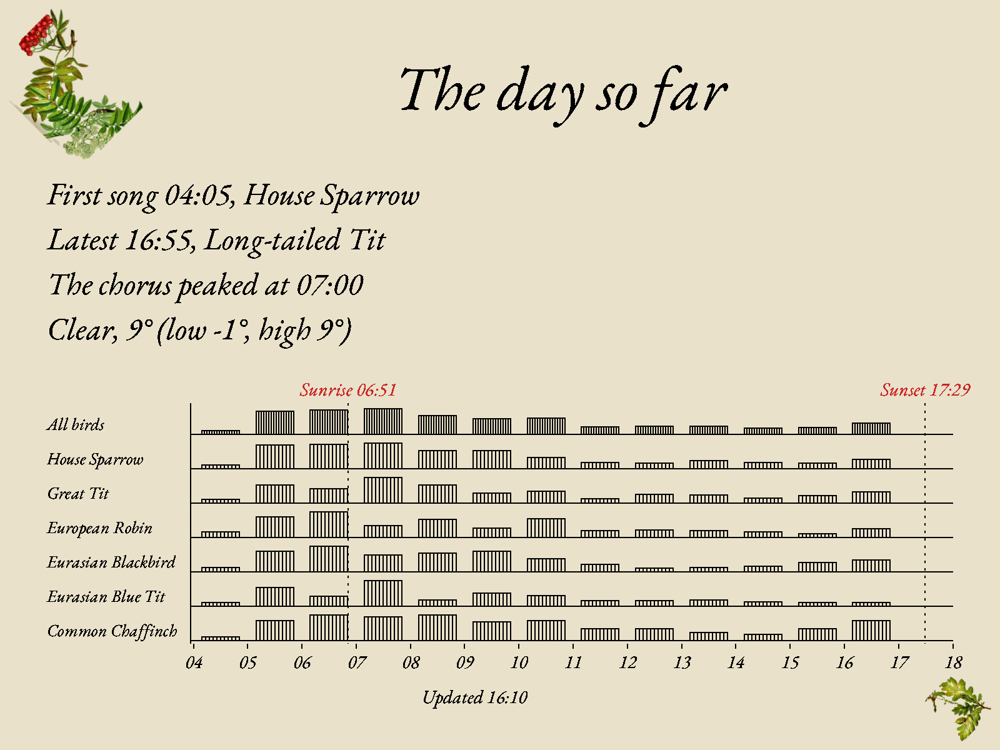
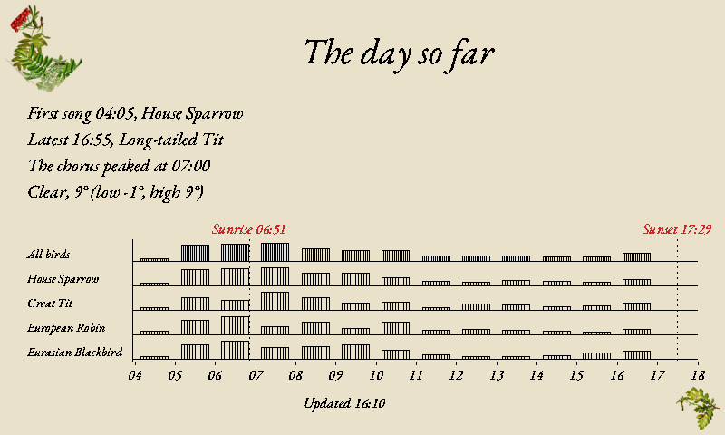
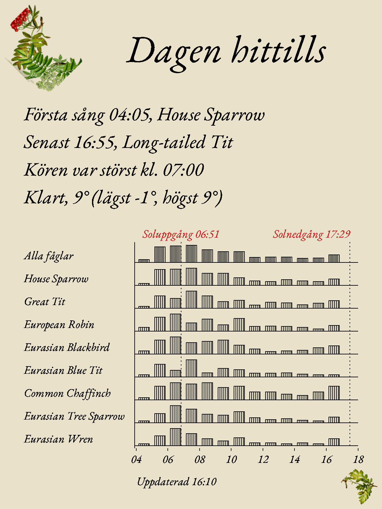
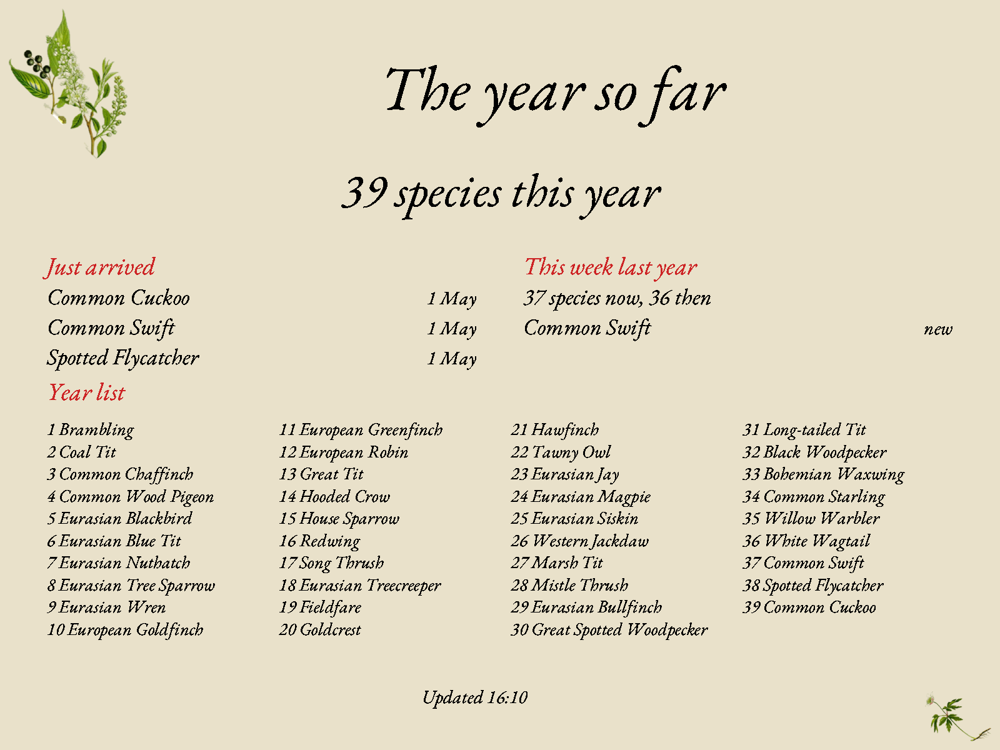
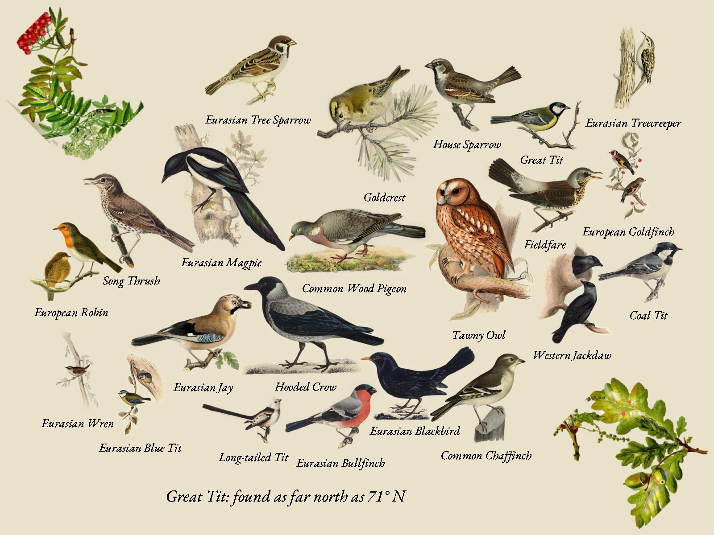
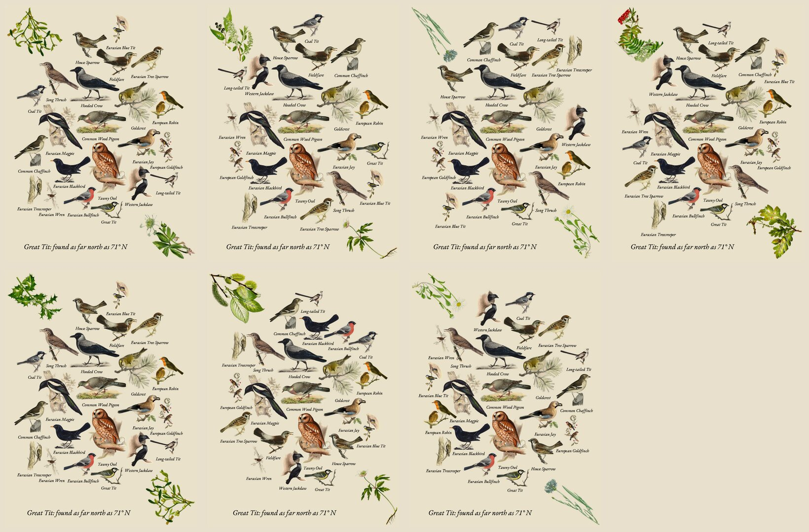

# Pages and views

A frame can show five pages. It asks for one with `view=`; the previous and next buttons of the
EE02, the reTerminal E1002 and the standalone firmware step through all five (see
[Firmware: Buttons](../reference/firmware.md#buttons)), and each frame in `FRAMES` has a default. Every page is drawn for whatever panel or screen asks,
in the frame's layout where the page has birds on it.

| View | Shows | From BirdNET-Go |
| --- | --- | --- |
| `today` (default) | The birds heard in the last `WINDOW_HOURS`, as a collage or a list | The species summary |
| `week` | The birds heard in the last seven days | The summary over seven days |
| `rarest` | Today's birds, rarest first: at most six on the collage, the rarest biggest | Today's summary, ranked by detections this year |
| `story` | The day so far: first and latest singer, the chorus's busiest hour, the weather, and a chart of when each bird sang | Today's summary, the hourly counts, and Open-Meteo |
| `season` | The year so far: species this year, recent arrivals, this week against the same week last year, and the year list | Summaries over the year, the last weeks, and last year's week |

## Today, with a new bird

When a bird is heard for the first time this year, it is the alert: today's and the week's pages
put it first and biggest, today's heading names it ("New this year: Bohemian Waxwing"), and the
story chart draws its row in red. While it was heard within `ALERT_MINUTES`, `/panel` tells frames
to sleep `ALERT_POLL_MINUTES` (5 minutes) instead of `POLL_MINUTES`, so a frame that wakes
on its usual schedule then keeps up while the bird is about. The server cannot wake a sleeping
frame; the shorter sleep takes effect from the frame's next wake.

"New for the year" counts from the 15th of January: on the first of January every bird is new,
and residents take a while to all be heard.

## Week and rarest

Rarity is the station's own: the fewer times a bird has been heard this year, the rarer. A
bird BirdNET-Go hears every day is never rare, however rare it is nationally, and a bird that
turns up once in a while is, however common elsewhere.

## The day's story

The chart is drawn the way the plates were printed: hairline rules, bars outlined and hatched like
an engraver's shading, dotted reference lines, and the italic serif of the rest of the page. Each
row is one of the day's eight most heard birds, plus any new for the year (first, hatched in red,
the rubric colour of old books); the top row, hatched closest, is every bird together. Bars are scaled per row, so a quiet bird's
pattern shows as clearly as a loud one's: the chart is about *when*, not *how many*. The chart
spans the hours anything sang, sunrise and sunset, and at least ten hours. Rows that do not fit at
a legible size are left off from the bottom, so the 7.3-inch panel shows fewer:

The weather line and the sunrise and sunset marks come from [Open-Meteo](https://open-meteo.com/),
which needs no key, when `LATITUDE` and `LONGITUDE` are set. Without them the page leaves them
out.

## The season

- **Just arrived** lists the birds heard in the last 21 days that were not heard in the 60 days
  before: spring's migrants, autumn's winter thrushes, and rarities.
- **This week last year** compares the last seven days with the same seven days a year
  earlier, and names a few birds heard only now or only then.
- **Year list** numbers every species heard this year in the order they were first heard, like
  a birder's notebook. A long list is set smaller, then cut short with "and N more".

## A fact about the main bird

Today's, the week's and the rarest page end with one line about their main bird, the one drawn
first: a bird new for the year, the rarest, or else the most heard. Each species has up to ten
facts, and the line tells a different one each day, in an order of the species' own, so it
changes daily but not between wakes:

| Fact | Example | Source |
| --- | --- | --- |
| Weight, in sugar cubes of 4 g | Great Tit: weighs about 16 g, as much as 4 sugar cubes | AVONET |
| Wingspan | Eurasian Magpie: 56 cm from wingtip to wingtip | Wikidata |
| Incubation | Eurasian Blackbird: the eggs hatch after about 13 days | Wikidata |
| Oldest known | House Sparrow: the oldest one known lived 19 years | Wikidata |
| Range, against Europe | Great Tit: its range is 3 times the size of Europe | AVONET |
| How far north or south | Great Tit: found as far north as 71° N | AVONET |
| Migration | Common Swift: a migrant, with a summer home and a winter one | AVONET |
| Diet | Eurasian Bullfinch: eats almost anything | AVONET |
| Where it lives | Common Swift: spends most of its life on the wing | AVONET |

The table is built into the server and the standalone firmware (`crates/bird-facts`, about
260 KB); nothing is looked up online. Its sources, AVONET (CC BY 4.0) and Wikidata (CC0), are
credited in `crates/bird-facts/data/ATTRIBUTION.md` and NOTICE.md, never on the page. The words
are in English and Swedish; other languages fall back to English until translated (keys
`fact_*` and `food_*` in [Translations](../reference/configuration.md#translations)). `FACTS=false`
turns the line off.

## Seasonal borders

Every page wears a border of the season's plants: a spray hanging from the top-left corner and
one rising from the bottom-right, cut from the hand-coloured plates of Thomé's *Flora von
Deutschland, Österreich und der Schweiz* (1885), the same kind of period plate as the birds.
They are public domain and built into the program (`assets/borders/`, credited in its
`ATTRIBUTION.md`); nothing in the border is drawn by code. It changes with the date:

| Border | When | Top left | Bottom right |
| --- | --- | --- | --- |
| Frost | December to February | Mistletoe | Christmas rose |
| Blossom | March to May | Bird cherry in flower | Wood anemone |
| Meadow | June to August | Cornflower | Ox-eye daisy |
| Autumn | September to November | Rowan berries | Oak and acorns |
| Christmas | 13 December (Lucia) to 6 January | Holly | Mistletoe |
| Easter | Palm Sunday to Easter Monday | Pussy willow | Wood anemone |
| Midsummer | 19 to 25 June | Ox-eye daisy | Cornflower |

On the collage the birds are packed round the plants, by their outlines, as they are round each
other. On the list, story and season pages each spray fits the corner beside the heading or the
footer, which narrow to clear it. South of the equator (a negative `LATITUDE`) the seasons come
round half a year apart and Midsummer is not kept in June. `BORDER=off` leaves it off; a theme's
name keeps that one all year. The standalone ESP32 firmware carries the plants in its art bundle,
so a firmware built without art has no border.

## What it costs BirdNET-Go

Today's summary is asked for every `REFRESH_SECONDS`, as before. The rest (six more summaries,
the hourly counts, and the weather) only every `ALMANAC_MINUTES` (30) and when today's birds
change, so a new bird is featured within a minute of BirdNET-Go hearing it. The year's summary
is the heaviest query; BirdNET-Go answers it from its own database in well under a second on a
Raspberry Pi with a year of detections.

Pages are drawn when a frame first asks for them after the birds change, then kept, so a
frame that never asks for the season page never costs its drawing.
