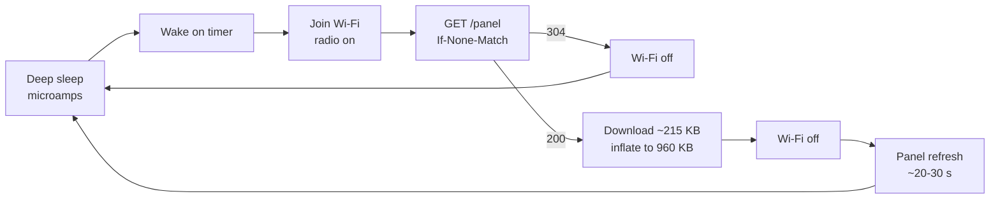

# Power, polling and refresh

On battery, what costs energy on the panel is how long the radio and the panel are active, not how
much the processor computes. Every design choice around refreshing follows from that.

## Where a wake spends its energy

- Most wakes end at the 304: the server only changes the page when the set of species changes.
- A real redraw is dominated by the panel refresh, which takes about 20 to 30 seconds.
- Joining Wi-Fi is the biggest cost of a 304 wake. Remembering the access point, channel and a
  static IP makes it much faster (planned for the firmware).

The figures in this page are rough estimates until the power milestone measures them.

## Why the panel polls instead of being pushed to

A board in deep sleep has its radio off, so it cannot receive a webhook or a push. Staying
reachable means staying on Wi-Fi, which draws roughly a hundred times more current than deep sleep
and turns months of battery into weeks. Redrawing on every detection would also flash the panel
for 20 to 30 seconds each time.

So the panel polls, and the server makes polling cheap:

| Technique | Where | Effect |
| --- | --- | --- |
| ETag and 304 | server | An unchanged page costs a few hundred bytes |
| Redraw only on a new species set | server | Most polls are unchanged |
| Poll interval as `Cache-Control: max-age` | server | `POLL_MINUTES` tells the panel when to come back; the server can lengthen it at night (planned) |
| zlib-compressed page | server | A new page moves about a quarter of the bytes |
| Length and Adler-32 checked before refresh | panel | A damaged or mismatched download never reaches the glass |
| Wi-Fi off during refresh | panel | The radio is only on while it is needed |

For a frame on USB power, a long-poll mode (the panel holds a request open and the server answers
when the page changes) is planned as an option.

## Why the page is compressed

A 13.3" page is 960,000 bytes of controller codes. Dithered birds compress well: the server's
zlib stream for a busy collage is about 216,000 bytes (7.3": 192,000 to about 45,000), within 7
percent of zlib's best level.

| | Uncompressed | Compressed |
| --- | --- | --- |
| Bytes on the wire, 13.3" | 960,000 | about 216,000 |
| Radio time at a typical 1 to 2 MB/s on an ESP32-S3 | about 0.5 to 1 s | about 0.1 to 0.2 s |
| Extra work on the panel | none | inflating, about 50 to 100 ms of CPU (the S3 has an inflater in ROM) |

The CPU is cheaper than the radio by a wide margin, so compressing always wins, but by less than
it sounds: the saving is roughly half a second of radio per new page, against a 20 to 30 second
refresh and the Wi-Fi join. It matters most on a weak signal, where throughput falls to a few
hundred kilobytes a second and the saving grows to several seconds. A 304 wake, which is most
wakes, is unchanged. These are estimates until the power milestone measures them.

Clients that do not send `Accept-Encoding: deflate` still get the plain bytes, which makes the
endpoint easy to test with any HTTP tool.
