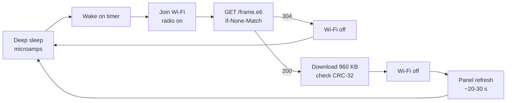

# Power, polling and refresh

On battery, what costs energy on the panel is how long the radio and the panel are active, not how
much the processor computes. Every design choice around refreshing follows from that.

## Where a wake spends its energy

- Most wakes end at the 304: the server only changes the page when the set of species changes.
- A real redraw is dominated by the panel refresh, which takes about 20 to 30 seconds.
- Joining Wi-Fi is the biggest cost of a 304 wake. Remembering the access point, channel and a
  static IP makes it much faster (planned for the firmware).

The figures in this page are rough estimates until the power milestone measures them.

## Why the panel polls instead of being pushed to

A board in deep sleep has its radio off, so it cannot receive a webhook or a push. Staying
reachable means staying on Wi-Fi, which draws roughly a hundred times more current than deep sleep
and turns months of battery into weeks. Redrawing on every detection would also flash the panel
for 20 to 30 seconds each time.

So the panel polls, and the server makes polling cheap:

| Technique | Where | Effect |
| --- | --- | --- |
| ETag and 304 | server | An unchanged page costs a few hundred bytes |
| Redraw only on a new species set | server | Most polls are unchanged |
| Poll interval in the page header | server | `POLL_MINUTES` tells the panel when to come back; the server can lengthen it at night (planned) |
| CRC-32 before refresh | panel | A damaged download never reaches the glass |
| Wi-Fi off during refresh | panel | The radio is only on while it is needed |

For a frame on USB power, a long-poll mode (the panel holds a request open and the server answers
when the page changes) is planned as an option.

## Why compression is optional

Compressing the payload would shorten downloads, but downloads only happen on the few wakes a day
where the birds changed, and those are dominated by the panel refresh. Compression will be added
behind the header's encoding byte only if measurements show it is worth it.
