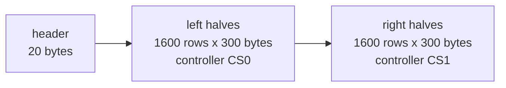

# The E6F1 page format

`/frame.e6` is a 20-byte little-endian header followed by the payload. It is the format
fugleramme defined for its EE02 firmware; birdnet-go-frame produces identical bytes.

## Header

| Offset | Size | Field | Value |
| --- | --- | --- | --- |
| 0 | 4 | magic | `E6F1` (ASCII) |
| 4 | 2 | version | `1` |
| 6 | 1 | encoding | `1` (nibbles) |
| 7 | 1 | poll minutes | 0 to 255; how long the client should sleep before asking again |
| 8 | 2 | width | `1200` (13.3", the glass in controller orientation) or `800` (7.3") |
| 10 | 2 | height | `1600` (13.3") or `480` (7.3") |
| 12 | 4 | payload length | `960000` (13.3") or `192000` (7.3") |
| 16 | 4 | payload CRC-32 | zlib / IEEE 802.3 CRC-32 of the payload |

## Payload, encoding 1

- The page is turned to the controllers' orientation: back from `ROTATION` to native landscape,
  then a quarter turn clockwise, giving 1200x1600.
- Each pixel is a 4-bit controller code: black 0, white 1, yellow 2, red 3, blue 5, green 6
  (4 is unused).
- Two pixels per byte, the left pixel in the high nibble.
- Every row's left half (600 pixels, for the first controller, CS0) comes first, row by row, then
  every row's right half (for the second controller, CS1).

## The 7.3" panel

fugleramme only packs for the 13.3" panel. For the 7.3" panel (`/frame.e6?panel=7.3`, or
`PANEL=7.3`) birdnet-go-frame uses the same header and encoding with a single controller's
layout: the page is turned back to native landscape (800x480) and its rows follow one another,
400 bytes each, with no split. A client tells the two apart by the header's width and height.

## Reading it on a device

1. Read 20 bytes and parse them with `frame_core::E6Header::parse`.
2. Check magic, version, encoding, width, height and length against the panel.
3. Stream the payload, feeding `frame_core::Crc32` as bytes arrive.
4. Refresh the panel only if the CRC matches.

Encoding 2 (compressed) is reserved for a later version; clients must reject encodings they do not
know.
