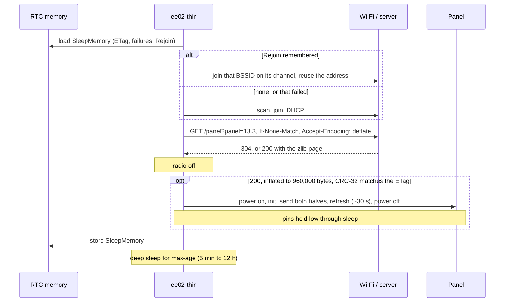

# The EE02 firmware

`apps/ee02-thin`: firmware for the Seeed XIAO EE02 (ESP32-S3, 8 MB octal PSRAM) and the 13.3"
Spectra 6 panel. [Build and flash the EE02 firmware](../how-to/flash-ee02-thin.md) shows how to
install it, and
[Supported hardware](supported-hardware.md) which other boards and panels work.

## Build-time settings

Read with `env!` when the firmware is compiled; changing one means building and flashing again.

| Variable | Required | Meaning |
| --- | --- | --- |
| `FRAME_WIFI_SSID` | yes | The Wi-Fi network's name, at most 32 bytes. 2.4 GHz only. |
| `FRAME_WIFI_PASSWORD` | yes | WPA2 (or WPA2/WPA3 mixed) password, 8 to 63 bytes; empty for an open network. |
| `FRAME_SERVER` | yes | The server as `a.b.c.d:port`, or `a.b.c.d` for port 8080. An `http://` prefix and trailing `/` are accepted. Host names are not: the panel skips DNS on every wake. |
| `FRAME_ROTATION` | no | `0`, `90`, `180` or `270`, sent as `rotation=`; unset leaves it to the server's `ROTATION`. |

## One wake

| Step | Limit |
| --- | --- |
| Join a remembered access point | 4 s, then a full scan |
| Full scan and join | 15 s |
| DHCP | 10 s |
| Connection stalled | 15 s |
| Response size | 1,000,000 bytes |
| Sleep | `max-age`, clamped to 5 min to 12 h; 15 min without one |
| After a failure | 5 min, doubled for each further failure in a row, up to 12 h |

What counts as a failure, and what is kept, follows `panel-wake`:

| Outcome | Glass | ETag kept | Rejoin kept | Sleep |
| --- | --- | --- | --- | --- |
| `304 Not Modified` | unchanged | same | yes | `max-age` |
| `200`, page checks out, panel refreshes | new page | the new one | yes | `max-age` |
| `200`, damaged, wrong length or not inflatable | unchanged | old | yes | back-off |
| `200`, panel fails | whatever the panel did | old, so it is fetched again | yes | back-off |
| Other status (e.g. `503` before the server's first page) | unchanged | old | yes | back-off |
| No Wi-Fi, no address, no connection | unchanged | old | no: next wake scans | back-off |

## RTC memory

`panel_wake::SleepMemory`, 14 little-endian words in RTC fast memory (esp-hal's
`#[ram(unstable(rtc_fast, persistent))]`, as atomics so no `unsafe` is needed):

| Bytes | Content |
| --- | --- |
| 0 to 31 | The ETag of the page on the glass, quotes included |
| 32 | ETag length |
| 33 | Failed wakes in a row |
| 34 | 1 when a rejoin record follows |
| 35 to 40 | Access point BSSID |
| 41 | Channel |
| 42 to 45 | The panel's IPv4 address from the last DHCP lease |
| 46 | Prefix length |
| 47 | 1 when a gateway follows |
| 48 to 51 | Gateway |
| 52 to 55 | CRC-32 of bytes 0 to 51 |

Words that fail the CRC read as a first boot: no page known, no rejoin.

## Pins

From Seeed's `XIAO_ePaper_Board_Configs.h`, by way of fugleramme's EE02 firmware.

| Signal | GPIO | Notes |
| --- | --- | --- |
| SPI clock | 7 | SPI2 at 10 MHz, mode 0 |
| SPI data out | 9 | |
| Chip select, first controller | 44 | Also UART0 RX |
| Chip select, second controller | 41 | |
| Data/command | 10 | |
| Reset | 38 | |
| BUSY | 4 | Input; low while the controllers work |
| Panel power | 43 | Load switch, high for power. Also UART0 TX. |

Because GPIO43 and GPIO44 are UART0's pins, the firmware logs over the ESP32-S3's built-in USB
serial port only (`esp-println`'s `jtag-serial`). After a refresh the panel is powered off and
clock, data, both chip selects, data/command and reset are held low through deep sleep, so the
idle panel is not fed through its inputs; the next wake that draws releases the holds.

## Toolchain and crates

| | |
| --- | --- |
| Target | `xtensa-esp32s3-none-elf`, `no_std`, `build-std = ["alloc", "core"]` |
| Toolchain | Espressif's Rust 1.98.1.0 from `espup` (named `esp`) |
| HAL | `esp-hal` 1.2, `esp-rtos` with embassy, `esp-radio` 1.0 beta for Wi-Fi, `embassy-net` for TCP/IP |
| Heap | 72 KiB of internal RAM reclaimed from the bootloader, plus the 8 MB PSRAM for the page |
| Image | about 510 KB; flashes at offset `0x10000` behind the ESP-IDF bootloader |

The firmware has its own Cargo workspace and `Cargo.lock` in `apps/ee02-thin`; the root workspace
excludes it and `crates/transport-esp`, so `cargo test --workspace` never needs the Xtensa
toolchain. See [Dependencies](../explanation/dependencies.md#the-firmware) for what it links.
