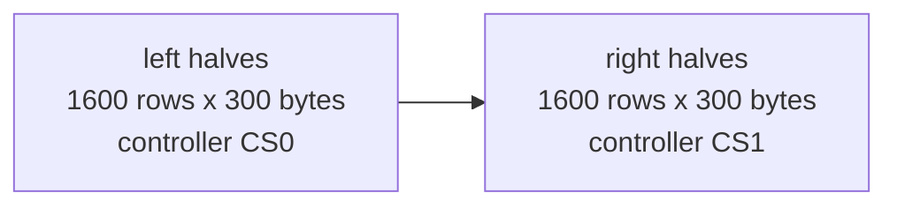

# The panel format

`/panel` sends a page as the panel's controllers take it: no header, no container, just the
pixels. A client that sends `Accept-Encoding: deflate` gets them as a zlib stream (RFC 1950),
about a quarter of the size; the bytes after inflating are the same.

## Request

```http
GET /panel?panel=13.3&rotation=90 HTTP/1.1
Accept-Encoding: deflate
If-None-Match: "b35332bb-z"
```

Both query parameters may be left out and then come from the server's `PANEL` and `ROTATION`.
A firmware should always send its own panel, so the server can never send it a page laid out
for another one.

## Response

| Header | Value | Use on the device |
| --- | --- | --- |
| `Content-Encoding` | `deflate`, only when asked for | Inflate the body as it arrives |
| `Content-Length` | Bytes on the wire | Know when the download is done |
| `ETag` | The CRC-32 of the inflated bytes in hex, quoted, with `-z` added for the compressed form | Send it back as `If-None-Match`; `304` means keep the panel as it is |
| `Cache-Control` | `max-age=<seconds>`, from `POLL_MINUTES` (`no-cache` when 0) | How long to deep-sleep before asking again |
| `Vary` | `Accept-Encoding` | For caches between the two |

After inflating, the body is exactly `width x height / 2` bytes. That length is the check that
the page fits the panel. zlib's Adler-32 at the end of the stream, or the CRC-32 in the `ETag`
for a client whose inflater does not check it, is the check that nothing was damaged on the way.
Refresh the panel only when both hold.

| Panel | Bytes | Typical on the wire (`deflate`) |
| --- | --- | --- |
| 13.3" | 960,000 | about 215,000 for a busy collage |
| 7.3" | 192,000 | about 45,000 |

## Pixels

- Each pixel is a 4-bit controller code: black 0, white 1, yellow 2, red 3, blue 5, green 6
  (4 is unused).
- Two pixels per byte, the left pixel in the high nibble.

### 13.3", two controllers

- The page is turned to the controllers' orientation: back from the rotation to native landscape,
  then a quarter turn clockwise, giving 1200x1600.
- Every row's left half (600 pixels, for the first controller, CS0) comes first, row by row, then
  every row's right half (for the second controller, CS1).



This is the payload of fugleramme's `/frame.e6`, byte for byte (checked by
`crates/frame-core/tests/panel_bytes_golden.rs`), without its 20-byte header.

### 7.3", one controller

The page is turned back to native landscape (800x480) and its rows follow one another, 400 bytes
each, with no split.

## Reading it on a device

1. Connect, send the request above, and read the status. On `304`, go back to sleep.
2. Inflate the body into the page buffer in PSRAM (`frame_core::inflate_zlib` needs no
   allocation; `panel-wake` does steps 2 to 5 and keeps the ETag in RTC memory).
3. Check the inflated length, and that the stream ended cleanly or its CRC-32 matches the `ETag`.
4. Send the bytes to the controllers in the order above, refresh, and keep the `ETag`.
5. Sleep for the `max-age`.

`apps/ee02-thin` does exactly this; see [the firmware reference](firmware.md).

## Why not fugleramme's `.e6`

fugleramme's EE02 firmware is MicroPython, where decoding a PNG is out of reach, so it asks for
the controller bytes as they are and puts a small header in front: a magic number, the panel's
size so a wrong page is caught, a CRC-32 so a damaged one is, and the minutes to sleep. Over HTTP
each of those already has a place: the request names the panel, the length after inflating
catches a mismatch, zlib and the `ETag` carry checksums, and `Cache-Control` says how long to
sleep.
Dropping the header lets the body be compressed, which `.e6` never was: the radio moves about a
quarter of the bytes for each new page.
