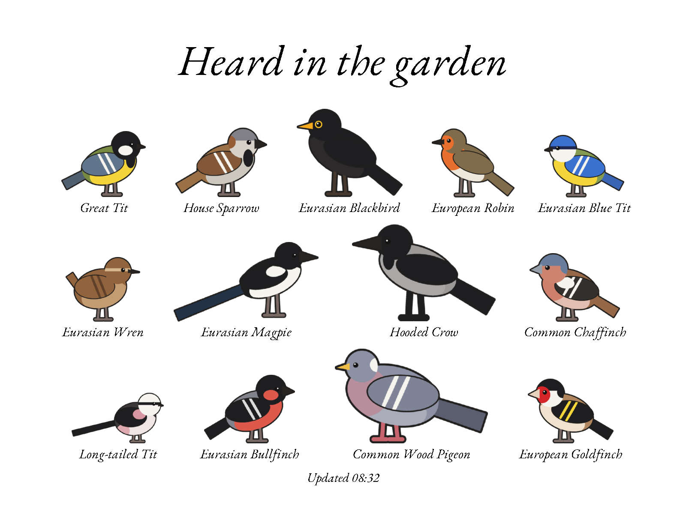

# Your first page, with the simulated BirdNET-Go

In this tutorial you build the server, run it against the built-in simulated BirdNET-Go, and look
at the page a panel would show. You need no microphone, no BirdNET-Go and no panel. It takes about
five minutes.

## What you need

- Rust (stable), from [rustup.rs](https://rustup.rs)
- A clone of this repository

## 1. Build and start the server

From the repository root:

```bash
BIRDNET_URL=mock UTC_OFFSET_MINUTES=60 cargo run --release -p server
```

`BIRDNET_URL=mock` tells the server to use the simulated station instead of a real one.
`UTC_OFFSET_MINUTES=60` puts the simulated garden's dawn chorus at your local time if you are on
UTC+1; use your own offset.

You should see:

```text
birdnet-go-frame: serving on http://0.0.0.0:8080/ from Mock
server: drew 13 species
```

The number of species depends on the time of day. Before dawn, the garden is quiet and the page
says "No birds heard yet".

## 2. Look at the page

Open <http://localhost:8080/> in a browser. You see the full-colour preview: a heading, a
picture of every species heard today with its name, and the time the page was drawn. Heavier
birds are drawn bigger, and every bird faces the middle of the page. The pictures are generated
(no artwork is downloaded), so they are simple, but they are sized and placed exactly as real art
would be.



Now open <http://localhost:8080/frame.png>. This is the same page reduced to the panel's six inks,
in the panel's native landscape orientation.

## 3. Ask for the page the way a panel does

```bash
curl -s -D - -o frame.e6 http://localhost:8080/frame.e6 | grep -i etag
```

Note the ETag, then ask again with it:

```bash
curl -s -o /dev/null -w "%{http_code}\n" -H 'If-None-Match: "<the etag>"' http://localhost:8080/frame.e6
```

The answer is `304`: the page has not changed, so a panel would go straight back to sleep.

## 4. Hang it portrait

Stop the server with Ctrl+C and start it rotated a quarter turn:

```bash
BIRDNET_URL=mock ROTATION=90 cargo run --release -p server
```

Reload <http://localhost:8080/>: the page is now 1200x1600 and the birds rearrange into more,
narrower rows.

## 5. Try the text page

```bash
BIRDNET_URL=mock LAYOUT=list cargo run --release -p server
```

The page now lists names and counts, most heard first, which some people prefer on a small
panel.

## What you have done

You ran the whole pipeline: fetching detections, laying out and drawing the page, dithering it to
six inks and packing it for the panel. Next:

- Point it at your real station: [Connect to your BirdNET-Go](../how-to/connect-birdnet-go.md).
- See what happened inside: [How the image is made](../explanation/image-pipeline.md).
